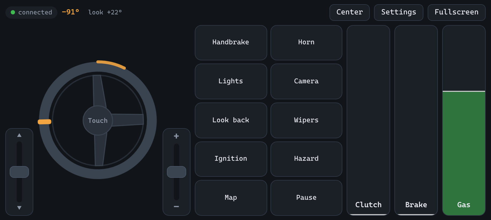
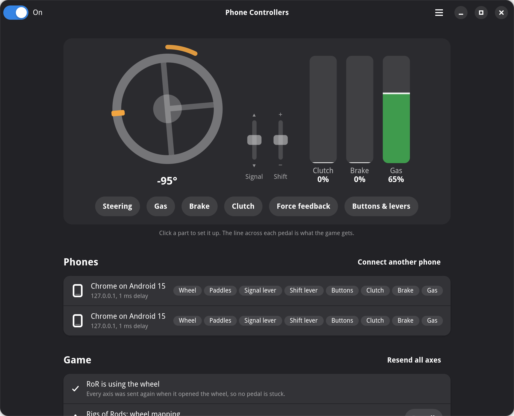
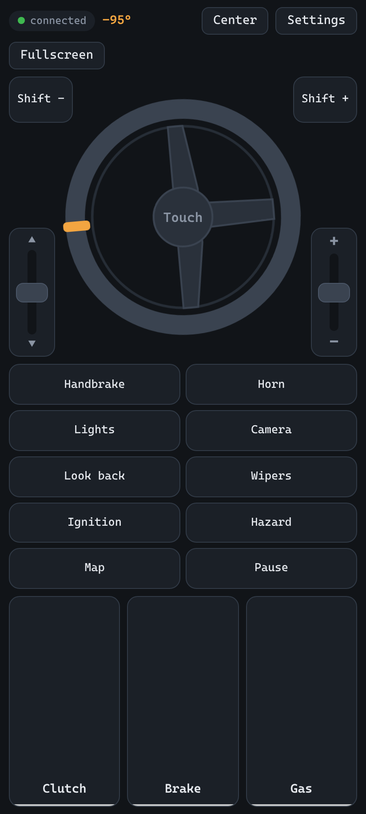

# Phone Controllers

**Your phone is the steering wheel. Another one is the pedals.**

Open a web page on your phone and your Linux PC gets a virtual joystick, the same kind of
device a plugged-in wheel is. No app on the phone, no driver on the PC.

<p align="center">
  
</p>

## Features

- **No app on the phone.** Scan a QR code and the phone becomes a wheel, pedals, gear lever
  and turn signals.
- **Force feedback.** When a game sends it, it turns the wheel on screen, and rumble
  vibrates the phone.
- **Several phones.** One as the wheel, one on the floor as pedals.
- **Two ways to steer.** Drag the wheel with your thumb, or hold the phone and turn it like
  a real wheel.
- **Look around.** Turn the phone to the side and the camera looks out the side window
  (Rigs of Rods for now).
- **Three ways to press a pedal.** Slide a finger, tilt the phone, or cover its back camera.
- **Driving details.** A clutch with a bite point, indicators that cancel after the turn,
  and a gear lever.
- **Your layout.** Move, resize and remove any control on the phone.
- **Set up on the PC.** A desktop app shows what the game gets, live, and holds every
  setting.

<p align="center">
  
  
</p>

## Which games

Tested with **Rigs of Rods**, which the app sets up in one click. Other games would need the
controls bound in their own settings, and some only accept specific wheel models or gamepads,
so they may not see it at all. None has been tried yet; reports are welcome.

> **Honest note:** this is vibecoded, built quickly with an AI assistant, and doesn't chase
> perfection. A phone isn't the perfect tool for the job either. It's meant to be good enough
> and a lot of fun.

## Install

Linux only. A Flathub release is on its way; until then, build the Flatpak:

```sh
git clone https://github.com/fxdave/PhoneControllers.git && cd PhoneControllers
flatpak-builder --user --install --install-deps-from=flathub --force-clean \
    build-dir flatpak/io.github.fxdave.PhoneControllers.yml
flatpak run io.github.fxdave.PhoneControllers
```

<details>
<summary>Or run it from source</summary>

Needs Python 3, GTK 4, libadwaita 1.7+ and PyGObject (`python-gobject gtk4 libadwaita` on
Arch).

```sh
python -m venv --system-site-packages .venv
.venv/bin/pip install -r requirements.txt
.venv/bin/python -m phonecontrollers
```

`.venv/bin/python server.py` runs it without a window.
</details>

## Start driving

1. Open **Phone Controllers** on the PC.
2. Scan the QR code with your phone (same Wi-Fi). Accept the certificate warning once:
   **Advanced → Proceed**.
3. Tap **Fullscreen** and drive.

The app walks you through the rest, including one-click setup for Rigs of Rods.

### If the app can't create the wheel

It needs access to `/dev/uinput`, which most desktop distros already give you. If not:

```sh
echo 'KERNEL=="uinput", GROUP="input", MODE="0660", TAG+="uaccess"' | sudo tee /etc/udev/rules.d/99-uinput.rules
sudo usermod -aG input "$USER"
sudo modprobe uinput && sudo udevadm trigger
```

Then log out and back in.

### If the phone can't reach the PC

Allow TCP ports 8765 and 8766 through the firewall.

<details>
<summary>Binding it in other games</summary>

The wheel shows up as a joystick called **Phone Controllers Wheel**: steering on `ABS_X`,
gas `ABS_Y`, brake `ABS_Z`, clutch `ABS_RZ`, look around `ABS_RUDDER`, buttons 1–12 on
`BTN_TRIGGER` … `BTN_BASE6`, the turn signals on `BTN_TRIGGER_HAPPY1`/`2`. It takes force
feedback (constant, spring, damper, periodic, rumble).
</details>

## Contributing

Run the tests with `.venv/bin/pip install pytest && .venv/bin/python -m pytest`. Releases are
described in [RELEASING.md](RELEASING.md).

## License

GPL-3.0-or-later. See [LICENSE](LICENSE).
