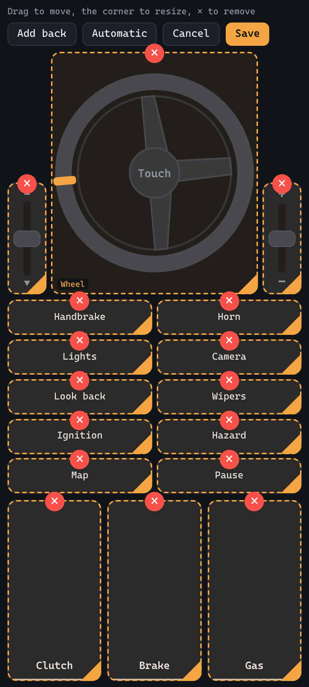
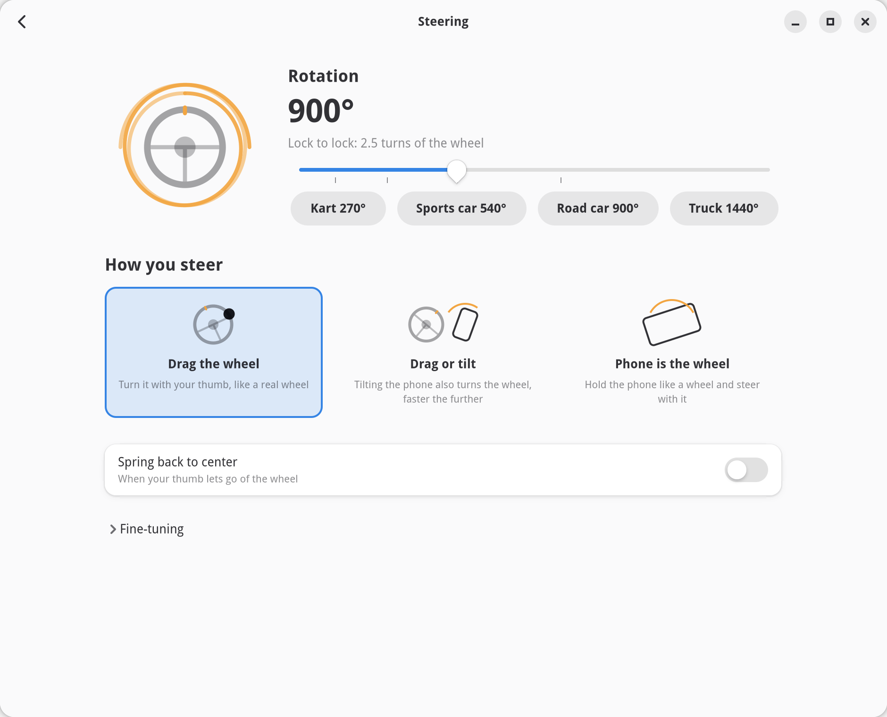
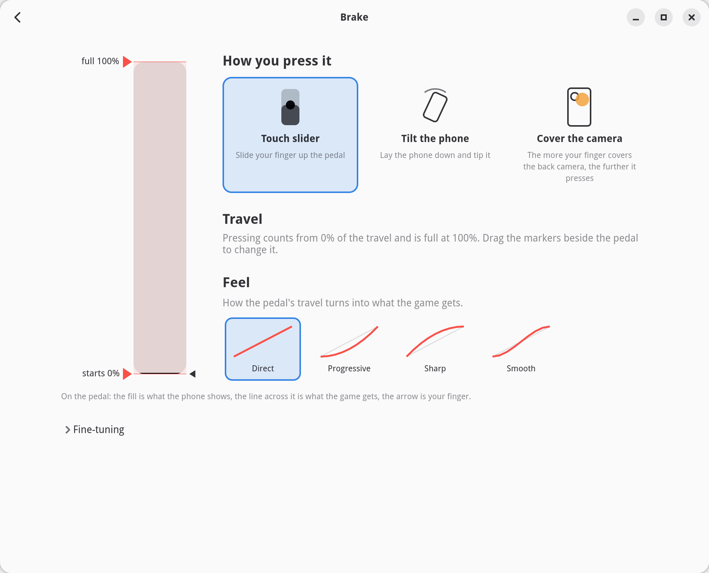
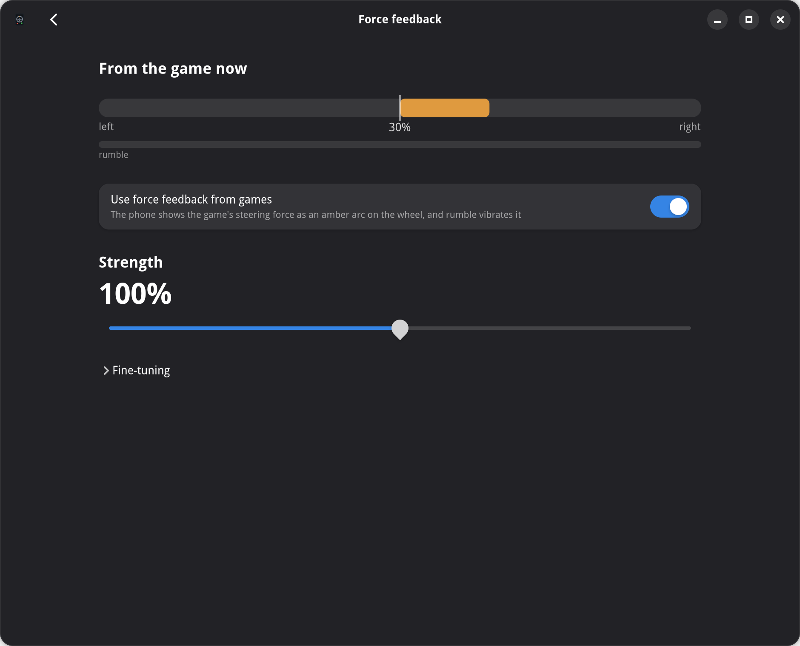
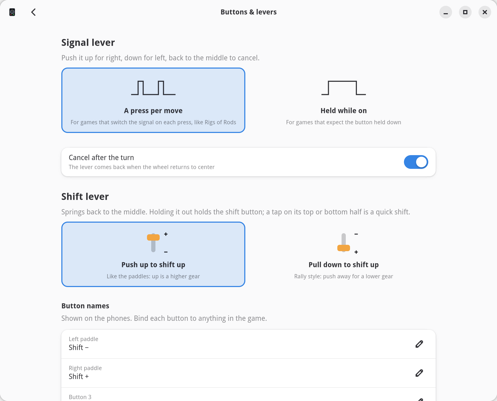

# Phone Controllers

Steering wheel, pedals, gear lever and turn signals from your phone's browser, for Linux.

Open a web page on your phone and the PC gets a real joystick that games, Steam and Proton
see like any wheel. No app to install on the phone, no driver to install on the PC. A desktop
app runs it all and holds every setting, so you can tune a pedal without holding it.

<p align="center">
  
  
</p>

Made for practising driving in simulators (Rigs of Rods, BeamNG.drive, City Car Driving, Euro
Truck Simulator) as much as for games: there's a real clutch, a turn signal lever that cancels
itself after the turn, and a sequential gear lever.

> **A note on expectations:** this project is vibecoded, built quickly with an AI assistant,
> and it doesn't aim for perfection. A phone isn't the perfect tool for the job either: no
> real force on your hands, no pedal under your foot, sensors that drift. It's meant to be
> good enough and fun. Issues and pull requests are welcome all the same.

## What it does

- **Nothing to install on the phone.** Any phone with a browser works. Scan the QR code in the
  app and you're driving.
- **Force feedback.** The game's steering force turns the on-screen wheel and shows as an arc
  around it; rumble vibrates the phone.
- **Several phones, one car.** One phone as the wheel, another on the floor as pedals. Each
  phone shows only the controls you give it.
- **Every way to press a pedal.** Slide a finger, tilt the phone, or cover the back camera:
  the more of the lens your finger covers, the further the pedal goes.
- **Tuned on the PC.** Pedal travel, response curves, steering rotation and force feedback are
  set in the desktop app and pushed to the phones live.
- **No stuck pedals.** When a game opens the wheel, every axis is sent again, so a brake the
  game assumed half-pressed is released.
- **Look around.** Turn the phone you steer with to the side and the game's camera turns
  with it.
- **Your layout.** Move, resize and remove every control on the phone, and pick which
  buttons each phone shows.

## Install

Phone Controllers is Linux only. A Flathub release is being prepared; until then, build the
Flatpak or run it from source.

### Flatpak

```sh
flatpak-builder --user --install --install-deps-from=flathub --force-clean \
    build-dir flatpak/io.github.fxdave.PhoneControllers.yml
flatpak run io.github.fxdave.PhoneControllers
```

### From source

```sh
python -m venv --system-site-packages .venv   # system packages give the app GTK 4 + libadwaita
.venv/bin/pip install -r requirements.txt
.venv/bin/python -m phonecontrollers           # desktop app
.venv/bin/python server.py                     # or: server only, no window
```

The desktop app needs GTK 4, libadwaita 1.7 or newer and their Python bindings
(`python-gobject`, `gtk4`, `libadwaita` on Arch). The server alone needs only
`requirements.txt`.

### Allow the virtual device

The PC side creates its joystick through `/dev/uinput`. Most desktop distros already give the
logged-in user access (check with `getfacl /dev/uinput`). If the app says it can't open it:

```sh
echo 'KERNEL=="uinput", GROUP="input", MODE="0660", TAG+="uaccess"' | sudo tee /etc/udev/rules.d/99-uinput.rules
sudo usermod -aG input "$USER"
sudo modprobe uinput && sudo udevadm trigger
```

Log out and in after changing groups.

## Connect a phone

Start the app, then scan its QR code with a phone on the same network. The phone shows a
certificate warning the first time (the PC uses a self-signed certificate, because browsers
only share motion sensors and the camera with secure pages): tap **Advanced → Proceed**.
Then tap **Fullscreen**. Landscape and portrait both work.

If the phone can't reach the page, check that a firewall allows TCP ports 8765 and 8766.

<p align="center">
  
</p>

## The controls

- **Steering wheel**: drag your thumb around it. It turns as far as the rotation you set
  (900° by default), so you lift and regrab like on a real wheel. Or hold the phone like a
  wheel and steer with it (gyro), or drag and tilt together. **Tap the hub** to switch between
  touch and gyro on the fly.
- **Clutch, brake, gas**: analog. Finger height sets how far the pedal is pressed. Each pedal
  can instead follow the phone's tilt, or the back camera. Lifting off the clutch lets it come
  up over half a second instead of dumping it.
- **Signal lever**: push up for right, down for left, back to the middle to cancel. Like in a
  car it cancels itself when the wheel comes back after the turn.
- **Shift lever**: a sequential shifter that springs back to the middle. Push up to shift up,
  or pull down (rally style).
- **10 buttons**: handbrake, horn, lights, camera, look back, wipers, ignition, hazards, map
  and pause by default. Rename them in the app and bind them to anything. Shift paddles are
  there too, hidden by default because the shift lever does the same.

### Look around

Turn on **Look around**, in the desktop app (its own page, under the cockpit) or in the
phone's Settings. Then turn the phone you steer with left
or right, like turning your head, and the game's camera follows: at the default setting,
turning the phone 30° looks 90° to the side. Rolling the phone to steer doesn't move the
view; only where the back of the phone faces counts. Tapping the **look** reading at the top
of the phone (or **Center**) makes the current direction straight ahead and puts the game's
camera back. Straight ahead also settles by itself over a few seconds while you look roughly
forward, so the sensors' drift doesn't add up.

It needs the phone's motion sensors, so the secure (https) address. It uses the gyroscope
rather than the compass, which speakers, the PC or a metal desk throw off. In Rigs of Rods
the camera turns at its own speed, so a quick look takes a moment to catch up.

### Camera pedal

Set a pedal to **Cover the camera** in the app. On the phone, **Settings → Camera pedal**
shows what the camera sees and how far the pedal is pressed. Tap **Uncovered now** and
**Covered now** while holding the phone the way you drive. Phones with several back cameras
let you pick the lens your finger covers, and **Smoothing** trades a steadier pedal for a
little delay.

### Pick what each phone shows

On the phone, **Settings** has a checkbox for every control and every button. In the
desktop app, the pencil next to a phone in the list does the same from the PC, so you can
set up a phone that's already mounted or lying on the floor.

### Customize the phone's layout



On the phone, **Settings → Customize layout** gives every control a border. Drag to move,
drag the corner to resize, tap × to remove. **Add back** brings removed controls back,
**Cancel** undoes everything, **Save** keeps it. Portrait and landscape keep separate layouts.

Removing the wheel, a lever or a pedal hands that control to your other phones, so one phone
can be the wheel while another lies on the floor as pedals. Every connected phone drives the
same device: steering and each pedal follow whichever phone turns or presses furthest, and
buttons combine.

<br clear="right">

## The desktop app

The home screen is a live cockpit: the wheel, levers and pedals move as the game gets them.
Click a part to set it up. Each page leads with the main choices, shown as pictures; exact
numbers and the curve editors sit folded under **Fine-tuning**.

| | |
|---|---|
|  |  |
| **Steering**: rotation (kart, sports car, road car and truck presets), how you steer, spring back to center. | **Pedals**: touch, tilt or camera; travel (drag the markers beside the pedal); feel. |
|  |  |
| **Force feedback**: the live force from the game, strength, direction, vibration on rumble. | **Buttons & levers**: how the signal lever presses, which way the gear lever shifts, button names. |

Every axis has two response curves:

- **Input → pedal**, applied on the phone: finger height or tilt to what the pedal shows. Make
  a long slider press fully at 70% of its travel, or add a dead zone.
- **Pedal → game**, applied on the PC: what the pedal shows to what the game gets. The clutch
  starts with a bite curve, because many games grab within the first few percent of clutch
  travel.

Settings live in `~/.config/phone-controllers/config.json` (inside the Flatpak:
`~/.var/app/io.github.fxdave.PhoneControllers/config/phone-controllers/`) and reach every
phone the moment they change. `server.py` reads the same file and follows edits.

## Reading back from the game

- **Force feedback**: the device takes constant, ramp, spring, damper, periodic and rumble
  effects. The steering force shows on the phone's wheel, and a released wheel follows it.
- **Axis resync**: Linux drops events that repeat an axis's current value, so a game that just
  opened the device only knows the pedals someone moved. The server resends every axis when a
  program opens the device and when a phone connects; **Resend all axes** does it by hand.
- **OutGauge telemetry** (UDP port 4444): games that send it (Live for Speed, BeamNG.drive)
  report their own gas, brake and clutch, shown as a mark on each phone pedal. Gear, speed and
  RPM appear on the phone and in the app, and the signal lever follows the game's indicators.

## Game setup

### Rigs of Rods

Rigs of Rods ignores a wheel until a mapping file named after it exists. The app's home screen
installs it with one click, or:

```sh
cp games/rigs-of-rods/Phone_Controllers_Wheel.map ~/.rigsofrods/config/
```

Restart the game. Steering, pedals, shifting, handbrake, horn, lights, camera, look back,
look around, hazards, turn signals, map and menu are mapped. After an update the home screen
shows when the installed mapping is out of date. "Ignition" is the starter (hold it) and
"Wipers" toggles the ignition switch.

Force feedback is off in Rigs of Rods until its gains are set. **Turn on** in the app does it
(close the game first; it rewrites its settings on exit).

### Other games

Bind the axes and buttons in the game's controller settings. The device is called
`Phone Controllers Wheel` and shows up as a joystick:

| Control  | evdev     | Range           |
|----------|-----------|-----------------|
| Steering | `ABS_X`   | -32767 … 32767  |
| Gas      | `ABS_Y`   | 0 … 1023        |
| Brake    | `ABS_Z`   | 0 … 1023        |
| Clutch   | `ABS_RZ`  | 0 … 1023        |
| Buttons 1–12 | `BTN_TRIGGER` … `BTN_BASE6` | |
| Signal lever (13 left, 14 right) | `BTN_TRIGGER_HAPPY1`, `BTN_TRIGGER_HAPPY2` | |
| Look around: camera turn speed | `ABS_RUDDER` | -32767 … 32767 |
| Camera reset when looking is recentered (15) | `BTN_TRIGGER_HAPPY3` | |

Test it with `jstest-gtk`, `evtest`, `fftest`, or Steam's controller settings.

## Good to know

- If a phone disconnects or its page goes to the background, everything that phone holds is
  released, so the gas never sticks.
- While a phone is connected, the PC doesn't start the screen saver, turn the screen off or
  suspend, since driving with a phone never touches the keyboard or mouse. When the last phone
  leaves, or the app stops or is killed, that's lifted again. Turn it off under **Connection**
  in the app's menu.
- Phones reload by themselves when the page is updated, as soon as no finger is on the screen.
- Vibration works in Chrome and Samsung Internet on Android, not in Firefox or on iOS. Android
  drops short browser vibrations while **Touch feedback** is off (Settings → Sound &
  vibration → Vibration & haptics).
- Keeping the screen awake needs the secure (https) address; on plain http, turn the screen
  timeout up.

## Development

```sh
.venv/bin/pip install pytest
.venv/bin/python -m pytest
```

The end-to-end test creates a real uinput device and plays a force feedback effect on it; it
is skipped without write access to `/dev/uinput`.

After changing Python dependencies, regenerate the Flatpak's pinned list with
`.venv/bin/python flatpak/generate-python-deps.py`. Releasing is described in
[RELEASING.md](RELEASING.md).

## License

GPL-3.0-or-later. See [LICENSE](LICENSE).
